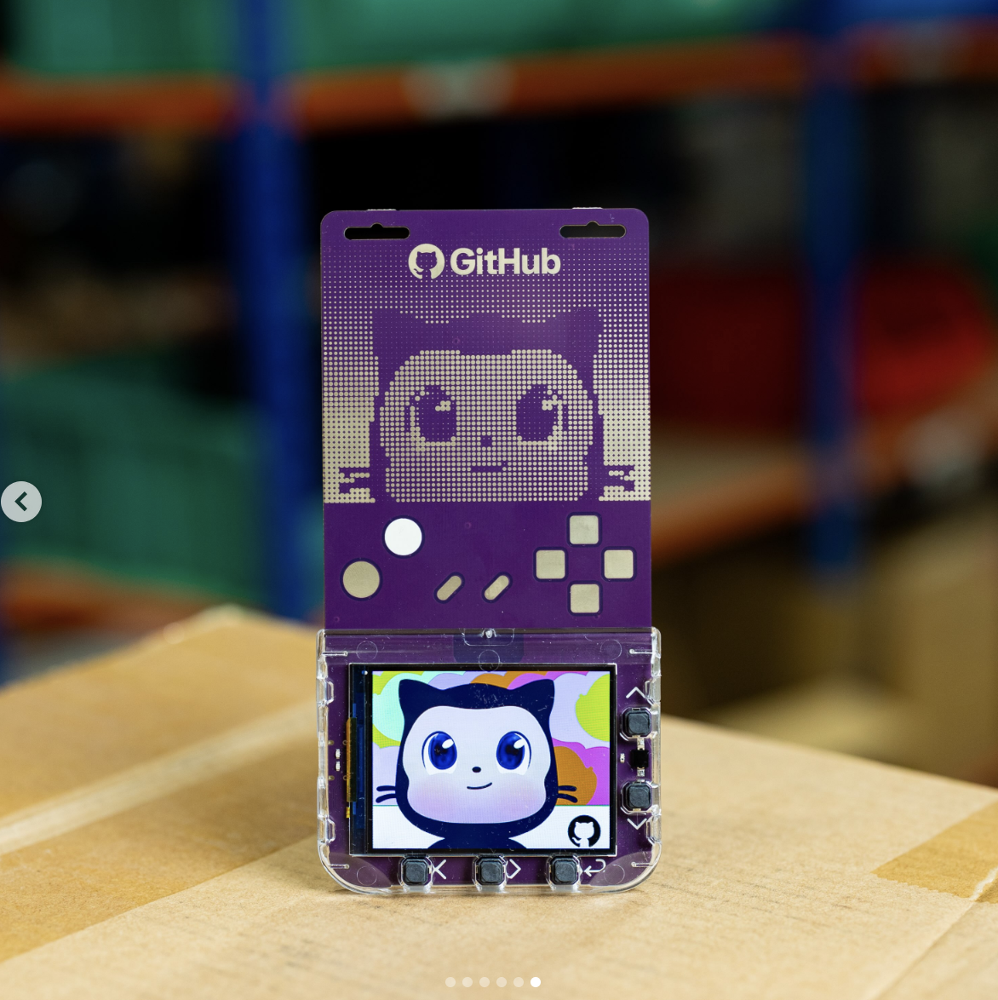

# Context: the badge portfolio

_Started Nov 17, 2026. This is the high-level brainstorm Jim and his assistant
began before moving the work into Claude Code._

## The idea

Redo jimburch.com as a **mobile-first portfolio homepage that feels like the
GitHub Universe 2026 badge**: a mix of a lanyard ID badge and really fun,
hackable tech. On a phone, you're essentially holding Jim's badge.

The spirit is the same as Wes Bos taking the stock badge and making it his own.
The portfolio should be Jim's personalized, hacked version of the badge, not a
replica of GitHub's.

## The reference badge

What's in the photo:

- A tall **purple PCB** card with a lanyard slot at the top, a **GitHub logo**
  and a big **pixel-art (halftone/dot) Mona the Octocat** in gold silkscreen.
- Game-console-style **silkscreen controls** on the board: a D-pad, round
  buttons and pill buttons (a Game Boy vibe).
- A **clear acrylic case** at the bottom holding a small **color LCD**
  (showing a cute rendered Mona) with real **physical buttons** around it
  (arrows, select/enter).

## References

- Instagram post with the series of Universe badges:
  <https://www.instagram.com/p/DeKs4SBlnIn/>
- Syntax, "the cure for ai burnout" (Wes Bos hacking the badge and making it his
  own): <https://www.youtube.com/watch?v=HYUNbJMe5Hc>
- Pimoroni RP2350 collection (where you can buy similar hardware). Its
  **Badgeware** line includes **Tufty** (color screen, closest to this badge),
  **Badger** (e-ink) and **Blinky** (LED matrix), each available as a badge or
  as a badge plus STEM kit: <https://shop.pimoroni.com/en-us/collections/rp2350>
- Related project: `~/Coding/personal/showit-badge/` is Jim's _physical_
  hardware hack of his Showit badge. It has a lit sound-reactive edge, NFC tap
  to connect, and an e-ink instant photo. The two projects can share ideas and
  visual language.

## Brainstorm seeds (not decisions)

- **The badge _is_ the page.** On mobile the viewport is the badge: a lanyard
  clip at top, a PCB face with a personal pixel-art avatar (Jim's own "Mona"),
  and a screen window.
- **The screen runs "apps."** Portfolio sections (About, Projects, Work,
  Contact, etc.) are tiny apps on the badge screen, with a boot sequence on
  first load and a launcher menu. A firmware or MicroPython flavor fits.
- **The buttons are the nav.** The D-pad and A/B buttons are real controls,
  backed by tap, swipe and keyboard.
- **Physicality.** The badge swings on its lanyard as you scroll or tilt the
  phone (device motion), haptics fire on button presses, and edge LEDs glow on
  interaction.
- **Make it his own, like Wes did.** Easter eggs (Konami code), a 1-bit
  dithered selfie "camera" app, a tap-to-share contact card, and maybe a
  "flash new firmware" moment.
- **Desktop.** The badge hangs centered on a workbench or lanyard scene. It's
  still the same badge, just with more room around it.

## Open questions

- Content: what should the portfolio actually say and show (projects, Showit
  work, Coati, writing, contact)? Who's the audience?
- How literal vs. stylized should the badge be? Pure CSS/SVG, canvas/WebGL, 3D?
- Stack and hosting: zero-JS-ish static site vs. a heavier interactive build.
- Performance budget on mid-range phones, and the fallback without motion or
  sensors.
- Does the old site's content carry over, and when does this replace
  `vanilla-portfolio` on jimburch.com?
